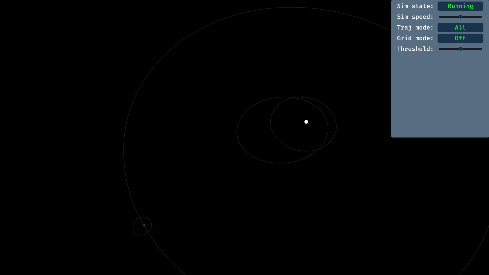
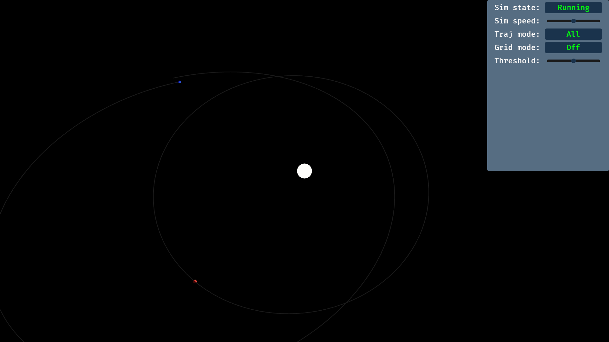
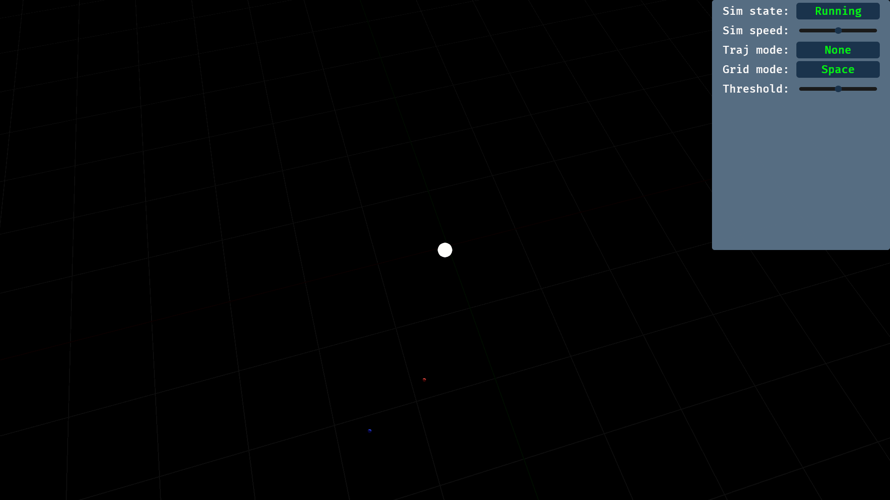
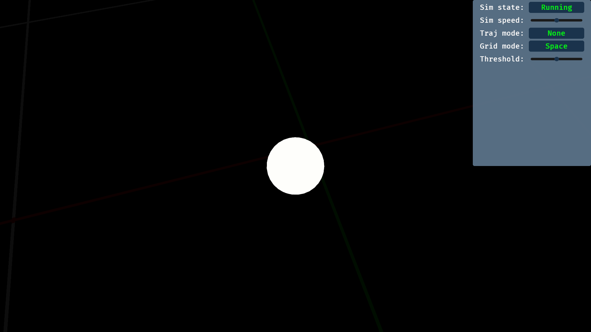
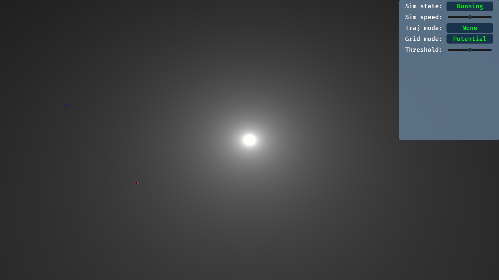
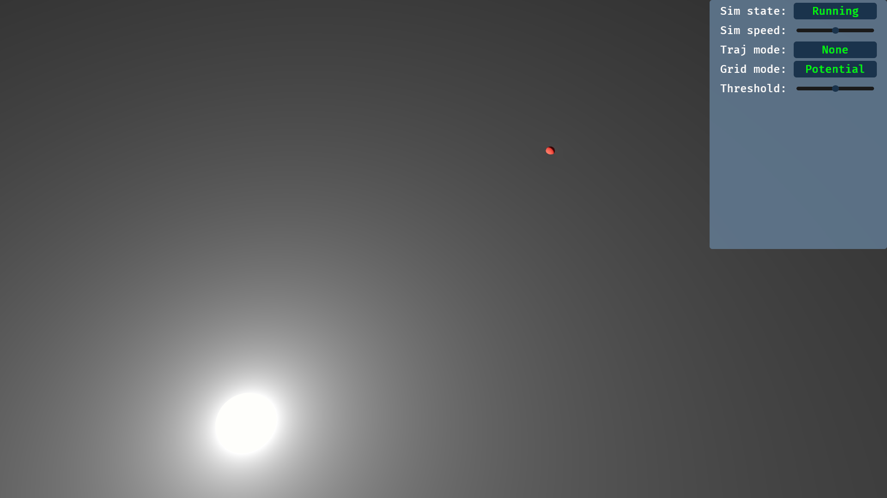
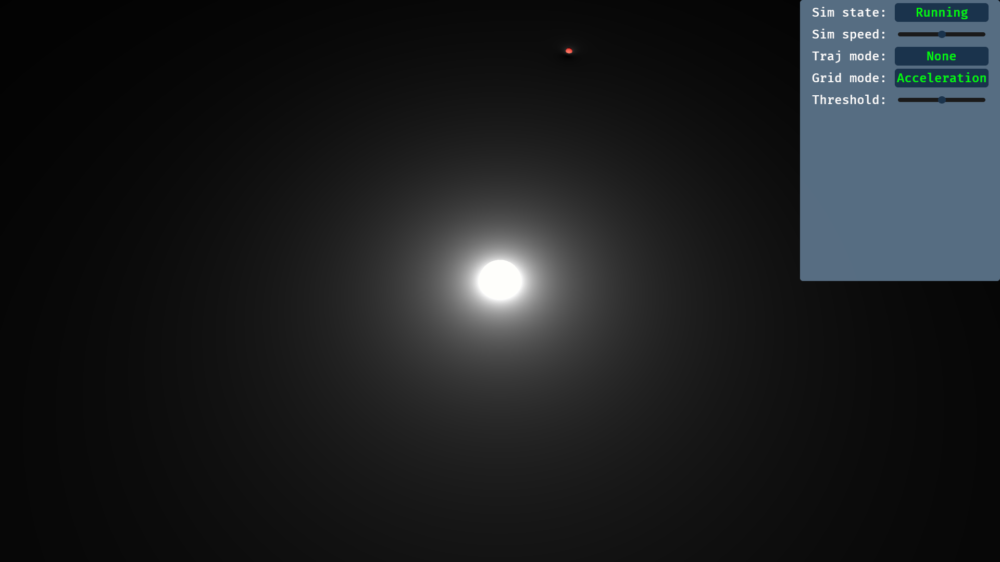
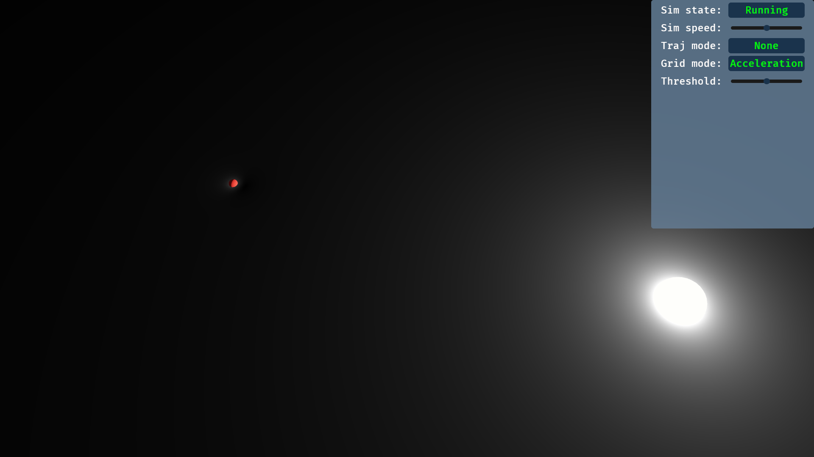
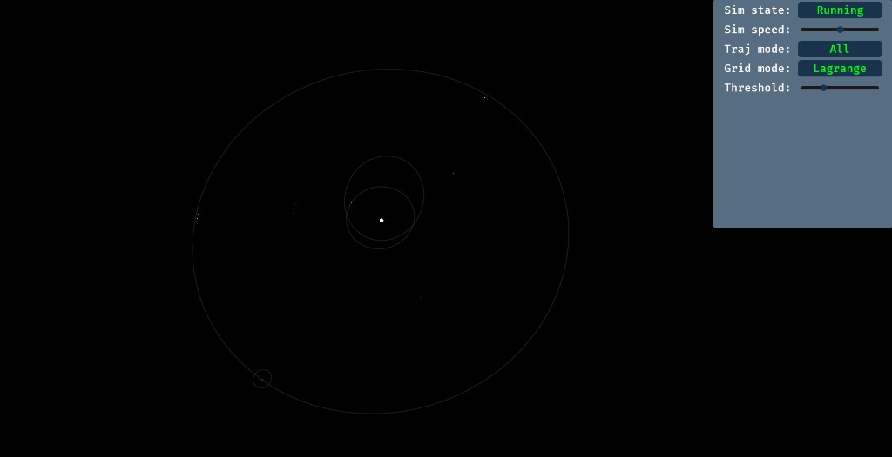

# bevy-practice

Bevy 0.20.1 practice project, version 0.1.5. A small n-body sandbox in the orbital plane: one star, two inner planets, an outer planet, and a moon. The same integrator steps the live bodies and the predicted paths, and a fullscreen shader plane can draw the gravity field those bodies produce.

### Building and running

WASM release: `cargo run --profile wasm-release`

Any other release: `cargo run --release`

Development: `cargo run --features bevy/dynamic_linking,bevy/file_watcher`

## Controls

The camera looks along the orbital plane, with +Z as up.

- **WASD** pans. Speed scales with distance from the look-at point, so a zoomed-out view still crosses the system in a few keypresses.
- **Right drag** orbits around the look-at point. Pitch stops before the view axis lines up with Z, so the camera cannot flip over the pole.
- **Scroll** zooms toward the look-at point.
- **Left click** a body to track it. The camera keeps its offset and follows that body each frame.

The panel on the right pauses the simulation, sets the speed, and switches trajectory and grid modes. The threshold slider only affects the Lagrange grid.

## Simulation

Gravity steps in `FixedUpdate` at 60 Hz with a semi-implicit Euler step. Every acceleration in a tick is computed from the positions at the start of that tick, then velocity is applied, then position. `integrate_bodies` does that on a plain array of samples. The live system copies bodies out, steps them, and writes the result back. The trajectory pass calls the same function, so a drawn line is the path the body will actually take.

`SimulationSpeed` does not change the tick. It sets `Time<Virtual>`'s relative speed, which changes how many 1/60 s ticks run per real second. The speed slider is centered on 1×: the left half covers 0.1×–1×, the right half 1×–50×. While paused, relative speed is 0, so virtual time stops. Bevy drops virtual time past a cap so a hitch cannot spiral; that cap grows with the speed multiplier, otherwise a fast simulation would throw away most of a stall.

Each body stores a central body: the strictly heavier body that pulls on it hardest. A moon close to a planet picks the planet. A planet picks the star. Massless or top-level bodies get no parent. That choice is what the trajectory and the Lagrange grid both parent against.

## Trajectories

Prediction runs up to ten minutes of fixed steps ahead, then keeps one revolution. For each body the central body is chosen once, from the positions at the start of the prediction. Re-picking it mid-line would jump the polyline by the gap between the two parents. The drawn point is the body's position relative to its parent, placed back on the parent's position at the start of the prediction. A moon therefore draws a loop around where its planet is now, including while that planet is moving during the prediction.

The revolution ends by watching the angle between the current radius vector and the original one. The angle climbs toward π and then falls. Once it has started falling and climbs again, the line stops. Vertices are kept at least 4 units apart, or 1.5% of the distance to the parent, whichever is larger, so the gizmo is not a stack of sub-pixel segments.

`All` draws every body. `Focused` draws only the body the camera is tracking. `None` draws nothing.

## Gravity grid

The grid is one plane lying in the orbital plane, with a custom material and a fragment shader in `assets/shaders/grid.wesl`. Each frame the CPU writes the bodies into a uniform buffer: position, velocity, mass, entity index, and central-body index, plus the heaviest mass and its radius. The shader switches on the HUD mode.

**Space** draws a reference grid on that plane. The axes through the origin are colored, and lines fade as they leave the camera target, so the grid stays a local ruler. Pulled back, it covers the inner system. Up close, the axes and the star's scale are readable.

**Potential** shades `mass / distance`, summed over every body and divided by the heaviest body's surface potential. At the scale of the inner planets the halo still reaches them. A closer framing keeps the star in view and puts a planet out in the falling gradient, so the curvature around that planet is readable without losing the source of the field.

**Acceleration** uses `mass / distance²` with the same surface normalization. The star's bright region collapses much faster than the potential. Pulled in on a planet, that planet's own well shows up as a small halo, and the star is still in the shot.

**Lagrange** looks for points that are nearly at rest in a two-body rotating frame. For each body that some lighter body treats as its central body, the shader builds that pair's barycenter and adds the two gravitational accelerations to the centrifugal acceleration of a circular orbit about the barycenter. Pixels where that sum is shorter than the threshold are drawn white. The threshold slider sweeps an exponential range. With trajectories left on, the passing regions show up along the orbits. A higher cutoff lights a stretch of the outer path. A lower one keeps only the narrowest marks.

## UI

Buttons and sliders are plain Bevy UI nodes. A style struct holds disabled, idle, hovered, and pressed colors, and one system applies them from `Hovered`, `Pressed`, and `InteractionDisabled`. Clicks and drags are emitted as events, so the HUD observers only match on an id. Label text is written into a `TextTable` and copied onto `Text` components later in the frame, which keeps the simulation systems off the text query.
